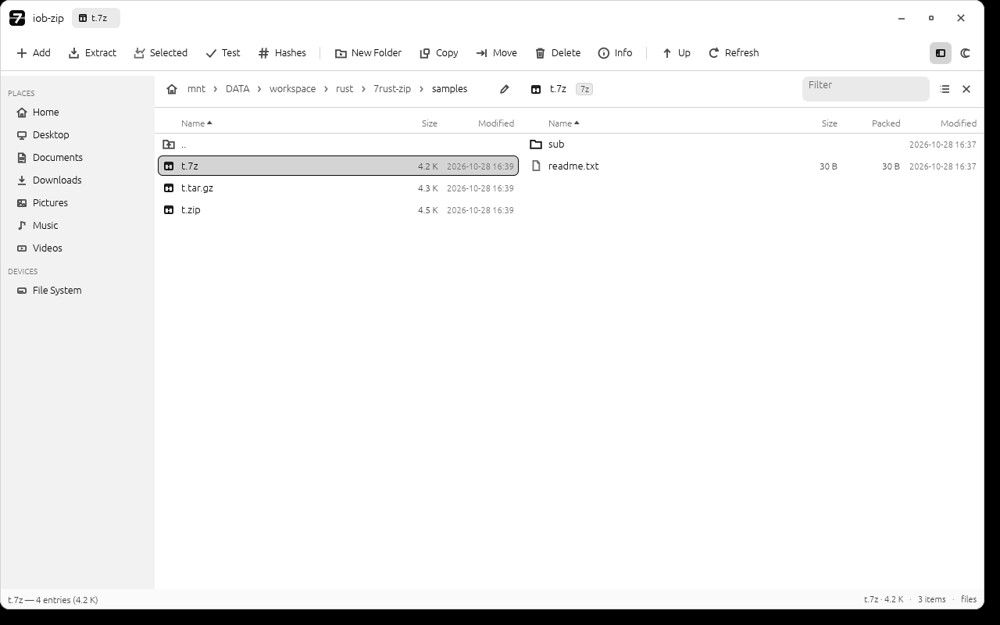
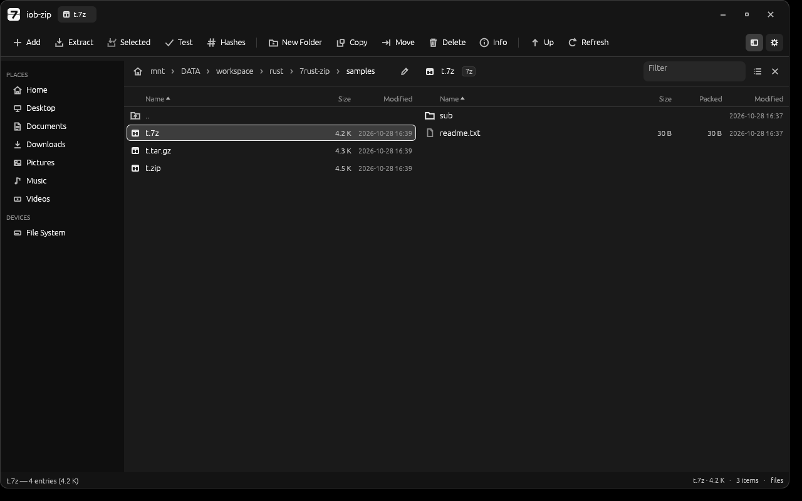

# CHOAB Zip

> **CHOAB** · شعب · *cha'b* — Arabic for "the people". شعبي (*sha'bi*) is the
> word Arabic uses for what is everyday, folk, of the people. CHOAB is that
> spirit in software: small tools, classic in form, quietly powerful in use.
> Family: **choab-zip** (archives) · **choab-player** (media) · **choab-press**
> (documents & printing).

A native, 7-Zip-style archiver for Linux, written in pure Rust. No Wine, no Qt,
no `7z` subprocess. One ~11 MB self-contained binary.

Archive browsing and text preview are native. Files the desktop handles
better (PDF, images, audio, video, office documents) are opened with the
system default application.

## Why

7-Zip's engine is excellent; its interface belongs to 2005. Linux deserves a
fast, native archiver with a single-pane layout and a modern shell around it —
black, white and grey, real icons, and no windows-inside-windows. That's all
this is.

## Features

| Feature | Status |
|---|---|
| **Archive Formats** (7z, zip, tar, tar.gz, tar.xz, tar.bz2, tar.zst) | list, extract, create |
| **Single-Stream Formats** (gz, xz, bz2, zst) | virtual listing & extract |
| **AES-256 Encryption & Password Protection** | interactive password prompt modal, encrypted 7z creation, header encryption (hidden file names) |
| **Compression Control** | levels 0-9 (Store..Ultra), solid blocks, codecs (LZMA2, LZMA, ZSTD, BZIP2, Deflate, Brotli, LZ4, Copy) |
| **Checksum / Hash Calculator** | pure Rust streaming CRC-32 & SHA-256 calculation dialog with one-click copy |
| **Native Image Viewer** | in-app view for PNG, JPG/JPEG, BMP, GIF, WEBP with zoom and dimensions |
| **Enhanced Text Viewer** | in-app view for code/text with substring search, match counter, word wrap toggle, copy to clipboard |
| **System Default App Delegation** | seamless temporary extraction & external launch for PDFs, audio, video, office docs |
| **Interactive Breadcrumb Navigation** | breadcrumb buttons + inline editable path bar for both filesystem and archive |
| **Multi-Selection & Batch Operations** | Ctrl+Click, Shift+Click, Ctrl+A, batch extract selected, batch delete |
| **Drag & Drop** | drop archives to open, drop files/folders to create archive or navigate |
| **Modern Interface** | header bar, flat command bar, places sidebar, vector icons, inspector viewer, centred dialogs |
| **Remembers where you were** | reopens the last directory, and the theme, from `~/.config/choab-zip/prefs.conf` (`last_dir=…`, `theme=light|dark|system`) |
| **Theme Switcher** | strictly greyscale; white by default, `Ctrl+D` toggles and the choice is remembered (`theme=system` follows the desktop scheme again) |
| **Single Content Pane** | the filesystem or the open archive, never squeezed side by side (`Ctrl+W` closes the archive, or the window when nothing is open) |
| **Keyboard Navigation & Shortcuts** | F5 (Copy), F7 (New Folder), Delete, Backspace, Enter, Ctrl+PgUp/PgDn, Ctrl+A, Ctrl+D, Esc, type-to-find |
| **Integrity Testing** | native CRC/decompression verification pass |
| **Cross-Platform & Pure Rust** | no Wine, no Qt, no external `7z` subprocesses, 100% pure Rust |

## Interface




One window, four regions:

```
header bar      app mark · open archive · window controls
command bar     Add · Extract · Selected · Test · Hashes │ folder & file ops │ Up · Refresh
sidebar         Places (Home, Desktop, Documents, …) and mounted devices
content pane    the filesystem — or, once an archive is open, its contents
```

One pane, not two. Opening an archive replaces the file list with the archive's
contents; `Ctrl+W` (or the ✕ in the archive header) closes it and the file list
comes back. With no archive open, `Ctrl+W` closes the window. That keeps the
whole width for whichever list you are actually reading instead of splitting it
in half.

- The viewer (text, images) docks **below** the content pane, so opening a file
  never squeezes the list.
- Icons are drawn as vectors on a single weight, so they stay crisp at any
  scale and never need asset files.
- The palette is strictly greyscale — no hue anywhere, including the accent —
  white by default, with `Ctrl+D` toggling and remembering the choice
  (`theme=system` in `~/.config/choab-zip/prefs.conf` follows the desktop).
- Columns drop from Packed to Modified to Size as a pane narrows, instead of
  overlapping.

### External apps only for non-text files

Archive work stays native: no `7z` subprocess, no external archiver. The
built-in viewer is reserved for small text files and images (up to 8 MB). When you open
a PDF, image, video, audio file, office document, or an unknown binary, the
entry is first streamed to a real path in `~/.cache/choab-zip/opened/`, then
handed to the desktop with `gio open` — which reaches the *host* desktop through
the OpenURI portal, the only thing that works from inside a Flatpak sandbox
(`xdg-open` starts, exits 0 and does nothing there). `kde-open` and `xdg-open`
are the fallbacks on systems without `gio`.

The copy is streamed rather than read into memory first, so a 2 GB video costs
2 GB of disk, not 2 GB of RAM. Copies older than three days are removed on
startup, and nested archives are unpacked under `~/.cache/choab-zip/nested/`
so a second instance can open them.

The cache lives in `$HOME`, not `$TMPDIR`: inside a Flatpak `/tmp` is a private
tmpfs, so a file written there is invisible to host applications and to other
instances — which is exactly what used to make "open with the system app" do
nothing.

## Damaged and half-downloaded archives

`tar`, `tar.gz`, `tar.xz`, `tar.bz2`, `tar.zst` and the single-stream `.gz` /
`.xz` / `.bz2` / `.zst` formats are **streams**: there is nothing to seek, so a
file that ends early still contains everything up to the break. choab-zip treats
that as data to recover, not as a failure:

- the archive **opens** and lists the entries that are actually readable,
  with a warning naming the reason instead of refusing outright;
- extraction **streams** — each file is written while it is decoded, never
  buffered whole — so it stops at the break with everything before it intact;
- **nothing is deleted.** Complete files stay, the fragment of the file that was
  being written stays, and a copy of the damaged source is left beside them as
  `<archive-name>.corrupt`;
- the status bar reports exactly what happened: how many files were extracted,
  which ones are incomplete, the reason it stopped, and where the damaged copy
  is. While work is in flight it shows live progress drawn from the source file
  size, switching to "unpacking · N written" once the source is fully read.

Compressed tar of zeros is a few hundred KB on disk for hundreds of MB of
output, so the readout deliberately keeps moving on the *write* side after the
input is exhausted.

Seekable formats behave differently: in `7z` the index lives at the end of the
last volume, so a split set or a truncated `.7z` cannot be recovered this way —
you get a hard error, exactly like `7z` itself. The same applies to split zip
(`.z01`, `.z02`, …), which the `zip` crate refuses outright.

### Multi-volume RAR

A RAR set (`name.part1.rar`, `name.part2.rar`, … or `name.rar` + `name.r00`, …)
is one file cut into volumes, so the parts are useless alone but complete
together. Any part can be opened:

- **the whole set is there** — clicking *any* volume opens volume 1 and `unrar`
  walks the chain, so extraction is complete even if you clicked `part7`;
- **the set is incomplete** — everything that lives entirely inside the volumes
  you *do* have is extracted, the walk stops at the first read that needs a
  missing volume, and the half-written file stays on disk;
- **a later volume on its own** — `unrar` refuses to open it, so the volume's own
  block headers are parsed instead (no decoder involved) and the files it
  declares are listed, marked as split, with a warning naming the parts that are
  present and missing.

Nothing is ever deleted to "clean up" after a partial run. When the report is
partial the app lists the incomplete files and the saved `.corrupt` copy in a
dialog, with **Keep files** and **Remove incomplete** — the decision is yours,
and closing the dialog keeps everything.

## Build

```bash
cargo build --release
./target/release/choab-zip
```

Requires a Rust toolchain and X11/Wayland dev headers (for `eframe`).

## Verify the engine without a display

```bash
./target/release/choab-zip --selftest path/to/archive.7z
```

Lists entries and extracts to a temp dir. Useful for CI and for checking
that a given codec works on your machine.

## Layout

- `src/engine.rs` — format detection, listing, extract, create. All archive
  logic lives here and is UI-agnostic, so it can be reused or tested alone.
- `src/main.rs` — application state: navigation, archive operations, worker
  threads and the dialogs.
- `src/ui.rs` — the interface: header bar, command bar, places sidebar, the two
  pane, the viewer dock and the status bar.
- `src/design.rs` — palette (strictly greyscale), type scale, the vector icon
  set and the small widgets everything is built from.
- `assets/icon*.png` — the app icon at every hicolor size (16–512), generated
  by `scripts/make_app_icon.py`; `assets/icon.png` is the 256 px one embedded
  in the binary.
- `assets/choab-zip.desktop` — launcher entry for the application menu.
- `scripts/make_appstream.py` — composes the AppStream catalogue entry that
  Flatpak expects, from the metainfo and the desktop file.

## Glyph guidance (IMPORTANT)

Every icon in the app is drawn with `egui::Painter` in `src/design.rs`, so
there are no icon fonts or PNG assets to keep in sync. Text labels are a
different matter: egui only bundles `Ubuntu-Light`, `Hack`, `NotoEmoji` and a
**subset** of `emoji-icon-font`. Most emoji are **not** included, so characters
such as 📁 📄 📂 📦 🗀 render as tofu boxes (`□`).

Glyphs verified present and safe to use:

```
★ ☆ ▶ ■ □ ● ✔ ✚ ⏏ ⚙ ☰ ✕ ✖ ⬆ ⬇ ⟳ ▣ · • … » ›
```

Do **not** use: 📁 📄 📂 📤 🗁 🗋 🖹 🔍 ▸ ▾ ▪ ◇ ◆ ↑ → ↩ ⌂ and the
box-drawing set (─ │ ├ └). To use a wider set, load a font with
`egui::Context::set_fonts`.

## Packages (.deb / Flatpak)

Both packages are built from the same release binary and ship the launcher
entry, the icon at every standard size (16–512 px) and AppStream metadata.

### Debian / Ubuntu

```bash
./scripts/package-deb.sh                 # cargo build --release + package
sudo apt install ./dist/choab-zip_*_amd64.deb
```

Requirements are derived from the binary's own shared objects
(`libc6`, `libgcc-s1`, `libstdc++6`); X11/Wayland/GTK/DBus are loaded at
runtime, hence only `Recommends` entries. Remove with `sudo apt remove choab-zip`.

Note that the binary links against the build machine's glibc, so building on an
older distro lowers the `libc6` floor (currently 2.39).

### Flatpak

```bash
./scripts/package-flatpak.sh
flatpak install --user dist/io.github.choab.Zip.flatpak
flatpak run io.github.choab.Zip
```

The script uses `packaging/flatpak/io.github.choab.Zip.yml`, which
builds against `org.freedesktop.Sdk//25.08` with the
`org.freedesktop.Sdk.Extension.rust-stable` extension — the manifest to submit
upstream. `flatpak-builder` can only see the *system* installation for
runtimes/extensions; when the extension is missing there, the script falls back
to `...local.yml`, which downloads a pinned Rust toolchain as a build source so
it works with an unprivileged user installation. Install `flatpak-builder`
itself with `flatpak install --user -y flathub org.flatpak.Builder`.

Without `flatpak-builder` the script falls back to `flatpak build-export` and
`cargo build --release`, which needs no SDK and no network. That path compiles
with the *host* toolchain, so it packages against the newest installed
`org.freedesktop.Platform` branch (the binary links the host glibc and cannot
run on an older runtime); the script checks both glibc versions and refuses to
build a bundle that would fail at startup. The `flatpak-builder` path keeps
using the manifest's `25.08`, because there the build happens inside that SDK.

Both scripts stage outside the source tree, so the checkout may live on a
filesystem that cannot store Unix permissions (NTFS/exFAT).

## Install the launcher (optional)

```bash
mkdir -p ~/.local/share/applications ~/.local/bin
for size in 16 22 24 32 48 64 128 256 512; do
    src="assets/icon${size}.png"; [ "$size" = 256 ] && src="assets/icon.png"
    install -Dm644 "$src" ~/.local/share/icons/hicolor/${size}x${size}/apps/choab-zip.png
done
cp assets/choab-zip.desktop ~/.local/share/applications/io.github.choab.Zip.desktop
ln -sf "$PWD/target/release/choab-zip" ~/.local/bin/choab-zip
update-desktop-database ~/.local/share/applications
```

## License notes

`sevenz-rust2` is MIT/Apache-2.0. This program does not link 7-Zip's own code,
so 7-Zip's unRAR restriction does not attach to it.

## Behavior parity with 7-Zip

Implemented by reading the real 7-Zip 26.05 FileManager source
(`CPP/7zip/UI/FileManager/`), not by guessing. Findings are recorded in
[docs-7zip-behavior.md](docs-7zip-behavior.md).

The rules that matter:

- **Double-click tries internal first**, then falls back to the OS handler —
  this is `CPanel::OpenItem(tryInternal)` returning `S_FALSE`.
- **Shift+double-click** skips the archive path entirely (`tryInternal=false`).
- **Folders sort before files in *both* directions**, because 7-Zip's
  `CompareItems` does the directory check *before* applying `_ascending`.
  This is a common thing to get wrong; there's a comment at that spot.
- **Default sort is Name, ascending** (`_sortID = kpidName`).
- Clicking the current column flips direction; clicking a new column starts
  ascending.
- A `..` row is pinned at the top of every listing.

### Interaction model & Keyboard shortcuts

Taken from the actual 7-Zip source; see [docs-7zip-behavior.md](docs-7zip-behavior.md).

- **Double-click a folder** → enter it.
- **Double-click an archive** → open it in the content pane (replacing the file list).
- **Double-click an archive inside an archive** → it is extracted to a temp
  folder and opened in a new choab-zip window, so nested archives never fight
  over the single content pane.
- **Double-click a text file** → preview it natively with syntax-agnostic viewer, search & wrap.
- **Double-click an image** (PNG, JPG, BMP, GIF, WEBP) → preview it natively in-app with dimensions.
- **Double-click a PDF, video, audio, office doc** → extract a temporary copy and launch system default app.
- **Enter / Ctrl+PgDn** → open the focused item (archive, folder, or file).
- **Backspace / Ctrl+PgUp** → go up one level (parent directory).
- **Arrows / Home / End / PageUp / PageDown** → navigate rows.
- **Ctrl+Click / Shift+Click** → multi-item selection.
- **Ctrl+A** → select everything in the content pane.
- **F5** → copy selected files to destination folder.
- **F7** → create new folder in current directory.
- **Delete** → confirm and delete selected items (files or folders).
- **Ctrl+W** → close the open archive (window stays); with nothing open, close the app.
- **Ctrl+D** → toggle Dark / Light theme.
- **Esc** → close preview or dialog / clear selection / cancel search.
- **Type-to-find** → typing jumps to the first matching name.
- **Drag and Drop** → drag archives or files directly into the window to open or compress.
